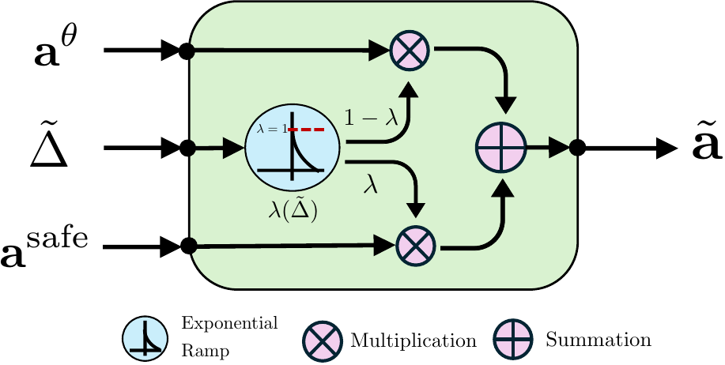
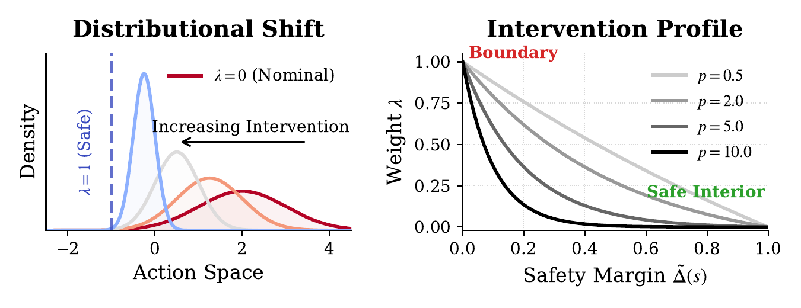

# AutoSafe


## Overview

AutoSafe is a safe-RL architecture for neural policies. A learned DRL policy is combined with a model-based
safe controller, and the blend between the two is set by a safety conditioned coefficient `λ`.
This repository contains the AutoSafe implementation, the baselines it is compared against, and the scripts
used to run and plot the experiments.

## Architecture

AutoSafe composes the action of the learned policy, `a^θ`, with the action of a model-based safe controller,
`a^safe`. The mixing weight `λ` is an exponential ramp of the normalized safety margin `Δ̃`. The final action is
`ã = (1 − λ) · a^θ + λ · a^safe`.

<p align="center">
  <br>
  <em>Action composition: the safety margin sets λ, which blends the learned and safe actions.</em>
</p>

Far from the safety boundary (`λ → 0`) the learned policy acts freely. As the margin shrinks, `λ` rises smoothly
to 1 at the boundary, shifting the action distribution toward the safe action rather than switching abruptly.
The exponent `p` controls how sharply the intervention ramps up.

<p align="center">
  <br>
  <em>Left: increasing intervention shifts the action distribution from the nominal policy (λ = 0) toward the safe
  action (λ = 1). Right: λ as a function of the safety margin for different values of p.</em>
</p>

**Methods** (selected with `JobParams.experiment_name`):

| `experiment_name`      | Method                                                   |
|------------------------|----------------------------------------------------------|
| `sac_autosafe`         | SAC + AutoSafe (proposed)                                |
| `sac_base`             | Plain SAC                                                |
| `sac_cbf`              | SAC + control barrier function                           |
| `sac_lag`              | SAC-Lagrangian                                           |
| `sac_lyapunov`         | Lyapunov-based safe RL                                   |
| `sac_residual`         | Residual policy on top of the model-based controller     |
| `sac_simplex`          | Simplex (switching) architecture                         |
| `sac_lam`              | SAC with a `λ` schedule (`sac_lam_mode`)                       |
| `model_based`          | Model-based controller only (no learning)                |

Variants: `sac_autosafe_vary_cartpole` and `sac_autosafe_vary` (Quadrotor) (varying-parameter / obstacle
settings), and `autosafe_traj_eval` / `simplex_traj_eval` (trajectory evaluation of trained agents).
Not every method is available in every environment; check the `experiment_name` branches in `job/<env>.py`.

## Repository layout

```
agent/
  OffPolicyRL/    SAC, SAC_AutoSafe, SAC_Lagrangian, SAC_Lam, replay buffer
  model_based/    Model-based designs (P matrix / gains) per environment
config/           Hydra base configs per environment
gym_env/          CartPole, Quadrotor, Glucose and Quadruped environments
job/
  <env>.py        Hydra entry point per environment
  experiments/    Training / evaluation loops per method
  scripts/        Shell scripts that launch multi-seed experiments
results/          Data processing and plotting scripts
```

## Setup

Tested with Ubuntu and Python 3.11.

```shell
conda create -n autosafe python=3.11
conda activate autosafe
pip install -r requirement.txt
```

The repository also ships prebuilt binaries (`mpc_osqp*.so`, `robot_interface*.so`) for the MPC and quadruped
interfaces in Quadruped experiments. These are built for CPython 3.10 on x86-64 Linux, so they will not import under the Python 3.11
environment above. Rebuild them for your interpreter if you need those components.

## Usage

### Run a job

Each environment has an entry point in `job/` configured with [Hydra](https://hydra.cc). Select the method with
`JobParams.experiment_name` and override any parameter on the command line:

```shell
python job/cartpole.py \
    JobParams.job_name=sac_autosafe_cartpole \
    JobParams.experiment_name=sac_autosafe \
    JobParams.seed=1 \
    SACParams.total_training_steps=200000
```

Other entry points: `job/quadrotor.py`, `job/glucose.py`, `job/quadruped.py`.
Add `--help` to any of them to list all configurable parameters.

Useful AutoSafe options:

- `SACParams.autosafe_lam_mode={opt,linear,exp}`: how `λ` is computed from the temperature.
- `SACParams.delta_min`: lower bound on the mixing parameter.

### Run the full experiments

Multi-seed launch scripts live in `job/scripts/`, with the rebuttal-round experiments in `job/scripts/rebuttal/`:

```shell
bash job/scripts/rebuttal/cartpole.sh
```

Each script runs seeds 1-5 and launches the method variants in parallel. Variants are toggled by commenting
lines in or out inside the script. Logs are written to `outputs/<env>/<job_name>/seed_<n>/`.

### Monitor training

```shell
tensorboard --logdir ./outputs/<FOLDER_NAME>
```

### Plot results

Plotting and statistics scripts are in `results/` (e.g. `plot_all_steps.py`, `plot_wall_time.py`,
`cal_statistics.py`). `results/data_preprocessing.py` collects the TensorBoard logs into the format they read.

## Citation

If you use this code, please cite:

```bibtex
@article{cao2026autosafe,
  title   = {Safe Online Learning via Smooth Safety-Structured Policy Composition},
  author  = {Cao, Hongpeng and Zhao, Liqun and Gu, Yuliang and Hovakimyan, Naira and Sha, Lui and Caccamo, Marco},
  journal = {Transactions on Machine Learning Research},
  year    = {2026},
  eprint  = {2606.31320},
  archivePrefix = {arXiv}
}
```
